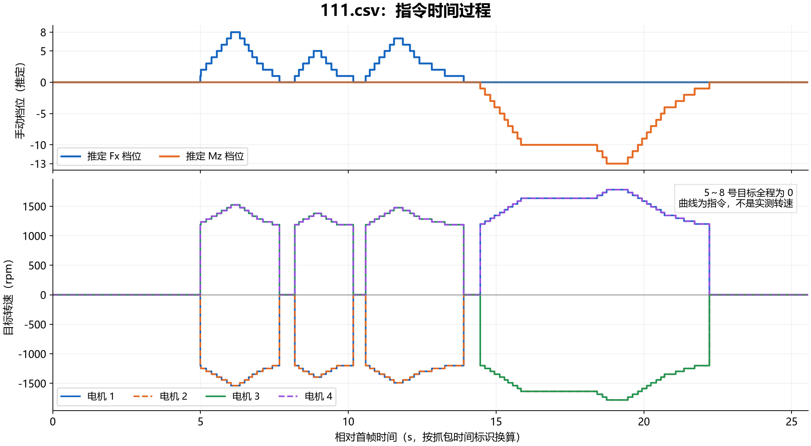
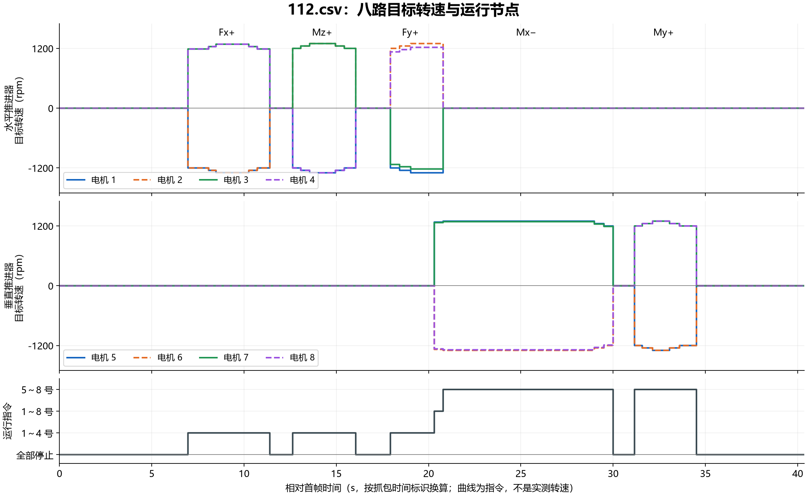

# 2026-10-08 CAN 指令抓包实例：111.csv 与 112.csv

[返回 README 文档索引](../../README.md#文档索引) · [抓包分析教程](../architecture/deployment/can-command-analysis.md)

## 本文索引

- [来源与证据范围](#来源与证据范围)
- [111.csv：三段 Fx 和一段负偏航](#111csv三段-fx-和一段负偏航)
- [112.csv：平移和姿态多轴操作](#112csv平移和姿态多轴操作)
- [组合指令切换的关键片段](#组合指令切换的关键片段)
- [模型力和耦合对照](#模型力和耦合对照)
- [共同结论与后续记录](#共同结论与后续记录)

## 来源与证据范围

| 文件 | 系统时间范围 | 总帧数 | SPEED / RUN 各自帧数 | 序号范围 |
|---|---|---:|---:|---|
| 111.csv | 20:23:49.415～20:24:14.985 | 2468 | 1234 | 0～2467 |
| 112.csv | 20:33:07.809～20:33:48.140 | 3948 | 1974 | 0～3947 |

两份文件均于 2026-10-08 分析，原始来源为本机桌面的同名 CSV。
两份导出内均只有 CAN ID `0x100`，版本 1、24 字节 CAN-FD、NodeMask=`FF`，
命令为 `0x10` 和 `0x11`。不据此断言其他反馈在总线上不存在。

整理本文时，111.csv 已不在原路径；该实例依据本次分析先前保留的逐帧解码结果和曲线整理，
未重新核验原始文件哈希。112.csv 在整理时仍可读取，其 SHA-256 为：

```text
87654D5713E4103330A4925A2DDEBFD1F51868F40D24F4949B163BD868AA5E8A
```

原始 CSV 未纳入仓库。图中时间以抓包时间标识差值按微秒换算；表格沿用导出的系统时间。
两列并非完全同步：111 的系统时间跨度约 25.570 秒，时间标识跨度为 25.5596 秒；
112 分别约 40.331 秒、40.3642 秒。周期和精确持续时间以时间标识为准，不混用两者。
本文只验证指令，未包含原始六轴 ROS 请求、电机反馈或实测推力。

方向与模型值使用当时的 [布局配置](../../internal/underwater_control/config/allocation.yaml)，
不是所有安装方式的通用结论。

## 111.csv：三段 Fx 和一段负偏航



图中的 Fx/Mz 档位是按当前手动映射推定的匹配输入，不是从原始 ROS 请求读取的值。

| 系统时间 | 输出特征 | 匹配的手动档位变化 | 1～4 号峰值 RPM |
|---|---|---|---|
| 20:23:49.415～54.443 | 全停 | 0 | `[0,0,0,0]` |
| 20:23:54.443～57.060 | 第一次 +Fx | `1→8→1→0` | `[-1539,-1539,1524,1524]` |
| 20:23:57.662～59.580 | 第二次 +Fx | `1→5→1→0` | `[-1394,-1394,1380,1380]` |
| 20:23:59.981～20:24:03.304 | 第三次 +Fx | `1→7→1→0` | `[-1491,-1491,1476,1476]` |
| 20:24:03.909～11.662 | -Mz，负偏航 | `-1→-10→-13→-1→0` | `[1782,-1782,-1782,1782]` |
| 20:24:11.662～14.985 | 全停 | 0 | `[0,0,0,0]` |

表中各运动段之间的空隙均为全停。5～8 号全程为零。
偏航阶段约在 20:24:05.322～07.841 保持 `±1636 rpm`，随后升至 `±1782 rpm`，再逐级下降。

检查结果：

- 1234 组速度/运行帧配对全部一致，序号连续。
- 运行帧中 `RunMask=0F` 共 787 帧，`00` 共 447 帧。
- 非零目标绝对值范围为 1188～1782 rpm。
- 连续运行段内速度更新间隔为 19.6～20.4 ms，约 50 Hz。
- 最后明确停止帧为记录 2129，系统时间 20:24:11.662；记录 2130 清零速度。
- 后续所有输出保持停止，未发现抓包结束前重新运行。

该实例中 +Fx 的垂直补偿没有出现在下发端，模型输出包含负向俯仰力矩。
这与弱补偿通道被停机死区清零的行为一致，但没有原始分配话题，不能直接证明上游状态。

## 112.csv：平移和姿态多轴操作



| 系统时间 | 输出特征 | 代表性的 1～4 号 RPM | 代表性的 5～8 号 RPM |
|---|---|---|---|
| 20:33:14.709～19.140 | +Fx，加档再减回零 | `[-1297,-1297,1284,1284]` | `[0,0,0,0]` |
| 20:33:20.446～23.870 | +Mz，正偏航 | `[-1297,1297,1297,-1297]` | `[0,0,0,0]` |
| 20:33:25.680～28.099 | +Fy，侧向平移 | `[-1297,1297,-1221,1221]` | `[0,0,0,0]` |
| 20:33:28.099～28.602 | +Fy 与 -Mx 组合 | `[-1297,1297,-1221,1221]` | `[1278,-1278,1267,-1267]` |
| 20:33:28.602～37.767 | -Mx，横滚输出，之后减档 | `[0,0,0,0]` | `[1297,-1297,1286,-1286]` |
| 20:33:38.977～42.296 | +My，俯仰 | `[0,0,0,0]` | `[-1297,-1297,1297,1297]` |
| 20:33:42.296～48.140 | 全停 | `[0,0,0,0]` | `[0,0,0,0]` |

表中运动开始前、独立运动段之间的空隙均为全停；Fy、组合输出与横滚三行之间没有全停。
Fx、偏航与俯仰的最大通道转速均为 `1200→1248→1297→1248→1200→0 rpm`，
匹配当前默认手动档位 `1→2→3→2→1→0`。

横滚阶段约在 20:33:28.602～36.760 保持同一组目标，约 8.2 秒，随后减至
`[1248,-1248,1238,-1238]`、`[1200,-1200,1190,-1190]`，最终清零。
指令持续保持是抓包事实，不代表电机实际一直达到该转速。

检查结果：

- 1974 组速度/运行帧全部配对一致，序号连续。
- 运行帧掩码计数：`00` 为 809 帧、`0F` 为 512 帧、`FF` 为 24 帧、`F0` 为 629 帧。
- 非零目标绝对值范围为 1130～1297 rpm，没有越界值。
- 连续运行段更新周期约 20 ms，运行帧间隔为 19.6～20.5 ms。
- 同组两帧间隔为 0.2～0.4 ms；每次更新两帧，运行时约 100 帧/秒。
- 最后明确停止帧为记录 3359，系统时间 20:33:42.296；记录 3360 清零速度。
- 垂直四台的转速代数和始终为零；按当前相同线性比例，净 Fz 为零，不能解释成升沉试验。

## 组合指令切换的关键片段

112.csv 中最需要同时对照 ROS 输入的部分是：

| 首条速度记录号 | 系统时间 | 完整 RPM 向量 | 随后 RunMask |
|---:|---|---|---|
| 1809 | 20:33:26.790 | `[-1297,1297,-1221,1221,0,0,0,0]` | `0F` |
| 1937 | 20:33:28.099 | `[-1297,1297,-1221,1221,1278,-1278,1267,-1267]` | `FF` |
| 1985 | 20:33:28.602 | `[0,0,0,0,1297,-1297,1286,-1286]` | `F0` |

八台运行的中间状态包含 24 组指令，按运行帧时间标识计算持续 0.4793 秒。
随后只剩垂直推进器输出横滚。这个结果不能唯一还原成“用户把 Fy 清零”。

可能原因包括用户主动减小/清零 Fy，也包括保留 Fy 但共同缩放后水平通道落入 1000 RPM 停机死区。
当前键盘代码不会在换轴时自动清掉其他轴，因此不能忽略后一种可能。
缺少 `control/manual_request`、`thruster_force_n` 和 `rpm_deadband_applied` 的同步记录，
本次不把其中任何一种解释定为已验证的根因。

若现场预期是“保持侧移，同时横滚”，应对照
[教程中的同步录包方法](../architecture/deployment/can-command-analysis.md#7-同步记录-ros-输入和反馈)
检查输入、死区前分配、死区后输出，以及最终电机反馈。

## 模型力和耦合对照

以下使用临时比例 `T_i=rpm_i/12` 和当前布局，合成的是下发目标对应的模型输出。
数值不是实测推力，也不等于原始六轴输入；真实推力曲线尚未标定。
计算方法见 [教程的模型反算](../architecture/deployment/can-command-analysis.md#6-反算模型力与死区影响)。

| 文件与工况 | 主要模型输出 | 附带模型力矩 |
|---|---|---|
| 111，Fx 1 档匹配值 | Fx ≈ +281.43 N | My ≈ -11.41 N·m |
| 111，Fx 峰值 | Fx ≈ +360.98 N | My ≈ -14.63 N·m |
| 111，负偏航峰值 | Mz ≈ -179.19 N·m | 其他分量约零 |
| 112，Fx 峰值 | Fx ≈ +304.17 N | My ≈ -12.33 N·m |
| 112，正偏航峰值 | Mz ≈ +130.42 N·m | 其他分量约零 |
| 112，Fy 峰值，垂直为零 | Fy ≈ +296.75 N | Mx ≈ +12.03 N·m |
| 112，八台运行的组合阶段 | Fy ≈ +296.75 N | Mx ≈ -98.95 N·m |
| 112，垂直横滚保持阶段 | Mx ≈ -112.63 N·m | 其他分量约零 |
| 112，俯仰峰值 | My ≈ +113.11 N·m | 其他分量约零 |

Fx/Fy 的姿态耦合来自水平推进器相对于模型原点的高度偏置。
当垂直补偿为零时，有 `My=-0.040532×Fx`、`Mx=+0.040532×Fy`。
不要把补偿被死区去掉后的下发输出，仍直接称为纯六轴请求的完整实现。

## 共同结论与后续记录

两份记录都没有发现指令序号跳变、速度/运行帧配对错误或非法非零转速，
并且在结束前有明确的全停命令。以上只覆盖所抓取的指令流。

后续重点是保留组合操作的原始输入与分配状态，确认弱通道何时跨入死区，
以及真实反馈是否跟踪目标。录包时至少包含原始输入、allocation、setpoint、thrusters/state、
gateway/status，并记录参数、源码版本和时间对齐方式。
这两份 CAN CSV 本身不提供实机转速跟踪、真实推力或姿态响应的验证。
